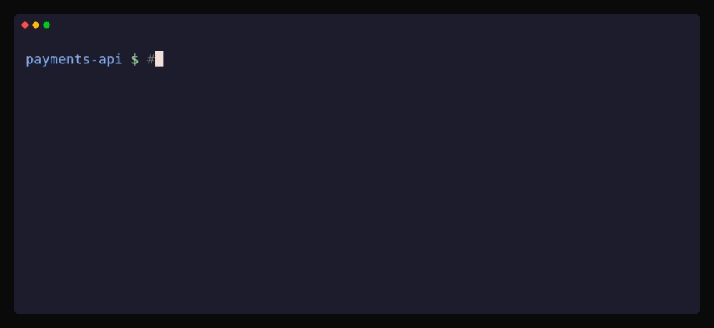

<div align="center">


<h1>Agentic Warden</h1>

<h3>Set agent rules once. Scope them by repository and IdP group, across Claude Code, Codex and Gemini CLI.</h3>



<a href="docs/site/quickstart.md">Quickstart</a> · <a href="docs/site/how-it-works.md">How it works</a> · <a href="docs/site/security-model.md">Security model</a> · <a href="docs/site/index.md">Docs</a>

</div>

## The problem

Claude Code, Codex and Gemini CLI each read their own settings, in their own format. Gemini CLI reached end of life on 2026-06-18. For its successor, Antigravity CLI (`agy`), aw writes an opt-in machine-wide file ([how it works](docs/site/how-it-works.md)).
Vendor consoles and managed settings files cannot scope a rule to one repository.
Neither carries a single policy across all three ([how it works](docs/site/how-it-works.md#compared-with-what-you-have-today)).

## See it work

This is a policy. The first rule applies everywhere. The second applies only to repositories whose origin matches `github.com/acme/payments*`.

```yaml
version: "quickstart.1"

rules:
  - name: baseline                # no match block: applies everywhere
    agents:
      claude:
        managed:
          permissions:
            deny:
              - Read(./.env)

  - name: payments-repos
    match:
      repos: ["github.com/acme/payments*"]
    agents:
      claude:
        managed:
          permissions:
            deny:
              - Bash(curl *)
```

In `payments-api`, Claude Code refuses `curl` even when the command allows it, because an organization deny overrides a developer's allow. In `sandbox`, the same command runs. The recording above is that run ([quickstart step 6](docs/site/quickstart.md#6-ask-claude-to-run-curl-in-both-repositories)).

## How it works

<p align="center">
  <picture>
    <source media="(prefers-color-scheme: dark)" srcset="docs/assets/architecture-dark.svg">
    
  </picture>
</p>

- **`awd` holds the policy.** `aw-sync` fetches each enrolled user's bundle from it on a timer and writes it to disk.
- **The agents read it on the laptop.** Claude Code runs the `aw-policy` helper at startup, so a developer who skips the `aw` wrapper is still governed. `aw codex` and `aw gemini` apply the rules for the repository you are in at launch.
- **Model traffic bypasses `awd`.** The control plane serves policy and is never in the path of an agent session.

## What you get

- **One policy for three agents.** One YAML file covers Claude Code (enforced) and Codex and Gemini CLI (advisory). See [write your first policy](docs/site/write-first-policy.md).
- **Scoped by repository and by group.** Rules match a repository pattern or an identity-provider group, and groups can come from Okta or Entra ID ([rules for a group](docs/site/write-first-policy.md#rules-for-a-group)).
- **Works offline.** `aw` compiles from the last synced bundle on local disk, so a stopped control plane leaves the policy in force ([quickstart step 7](docs/site/quickstart.md#7-change-the-rule-then-pull-the-plug)).
- **Signed bundles.** When you configure a signing key, each machine enrolled after that pins the key it is given at enrollment (trust on first use, so enroll over TLS) and verifies an Ed25519 or AWS KMS signature before it parses the body. Signing detects tampering and cannot stop a root user ([security model](docs/site/security-model.md)).

<p align="center"><br><sub><code>aw doctor</code> shows what <code>aw</code> compiled for this repository</sub></p>

<p align="center"><br><sub>A revision reaches the machine; the policy stays after <code>awd</code> stops</sub></p>

## How it compares

As of October 2026. This compares mechanisms only.

| Mechanism                    | Per repository | Per IdP group    | Claude Code, Codex, Gemini CLI |
|------------------------------|:--------------:|:----------------:|:------------------------------:|
| Vendor admin console         | ❌             | ➖ varies by vendor | ❌ one vendor each          |
| Managed settings files (MDM) | ❌             | ❌               | ❌ one format per vendor       |
| Agentic Warden               | ✅             | ✅               | ✅ one policy (Codex, Gemini advisory) |

Claude Code already ships managed settings, MDM delivery, server-managed settings, sandboxing and OpenTelemetry. What remains uncovered is per-repository rules, per-group policy for Claude Code on claude.ai seats, and one policy across the three agents ([details](docs/site/how-it-works.md#compared-with-what-you-have-today)).

## Questions your security team will ask

- **Do our code or prompts reach you?** No. `awd` is not in the path of an agent session, so it never sees prompts, code or model traffic. It sees enrollment and sync requests. In the hosted pilot we store your policies with their revision history, machine records (machine id, enrolled email, key id, last sync), identity-provider group membership, audit events (who applied what policy, and when) and service logs kept 30 days ([security model](docs/site/security-model.md#what-the-control-plane-sees), [trust statement](docs/hosting/trust.md)).
- **What if the server goes down?** A machine keeps the policy it has, with no expiry. A machine with a pinned signing key that holds a bad or missing bundle refuses to start Claude Code; with no pinned key it falls back to the static files. `requireBundle` overrides either way ([design limits](docs/site/security-model.md#design-limits)).
- **Can a developer bypass it?** Partly. Bare `claude` is governed, but a local administrator can edit the managed source or remove the drop-in, the `origin` remote that repository rules key on is the developer's to edit, and a developer's own Claude Code install is outside managed settings ([what it does not stop](docs/site/security-model.md#what-it-does-not-stop)).
- **What is not covered yet?** `awd` has no rate limit, the audit actor on the token path is caller-chosen, and two replays are not detected (same revision with older group membership, and a backwards control plane clock). `aw codex` and `aw gemini` are advisory. Co-signed revisions are planned and not built ([design limits](docs/site/security-model.md#design-limits), [threat model](docs/site/threat-model.md)).

You run `awd` yourself and hold the signing key. A hosted design-partner pilot also exists, on the terms in the [trust statement](docs/hosting/trust.md).

## Try it

These are the first 4 of the 7 [quickstart](docs/site/quickstart.md) steps. They need Linux or macOS, git and curl, and write nothing under `/etc`. Steps 5 to 7 add the refusal you saw above and need the `claude` CLI installed and logged in.

**1. Install the four binaries**

```sh
git clone https://github.com/alchristleo/agentic-warden.git
cd agentic-warden
REL=https://github.com/alchristleo/agentic-warden/releases
curl -fsSL $REL/latest/download/install.sh \
  | sh
export PATH="$HOME/.local/bin:$PATH"
git checkout -q "$(aw version)"
ls ~/.local/bin | grep '^aw'
```

You should see:

```text
aw
aw-policy
aw-sync
awd
```

**2. Start the control plane**

```sh
export AWD_ADDR=127.0.0.1:8080
export AWD_ADMIN_TOKEN=$(openssl rand -hex 16)
awd serve &
awd_pid=$!
sleep 1
```

You should see:

```text
listening on 127.0.0.1:8080
```

**3. Apply the two-rule policy above**

```sh
awd apply examples/quickstart.yaml
```

You should see:

```text
applied revision quickstart.1 (2 rules)
```

**4. Enroll this machine and sync**

```sh
export AW_SYNC_STATE_DIR=~/.aw-try
token=$(awd enroll-token you@acme.com)
AW_SYNC_TOKEN=$token aw-sync enroll --server http://localhost:8080 --agents claude --state-dir ~/.aw-try
aw-sync once --state-dir ~/.aw-try --root claude=$HOME/.aw-try/claude
```

You should see:

```text
enrolled machine
synced bundle quickstart.1: wrote 3 files
```

**Next:** [watch Claude refuse `curl` in one repository and run it in another](docs/site/quickstart.md#6-ask-claude-to-run-curl-in-both-repositories)

When you are done, stop the control plane with `kill $awd_pid` and [remove the trial](docs/site/removing.md#after-the-rootless-trial-quickstart).

---

<p align="center"><a href="docs/site/index.md">Docs</a> · <a href="docs/contributing/README.md">Contributing</a> · Apache-2.0</p>
