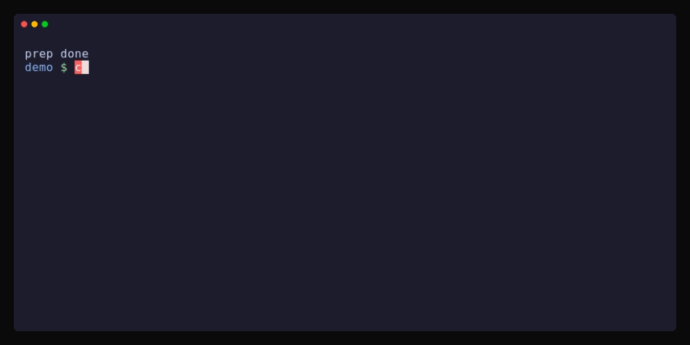
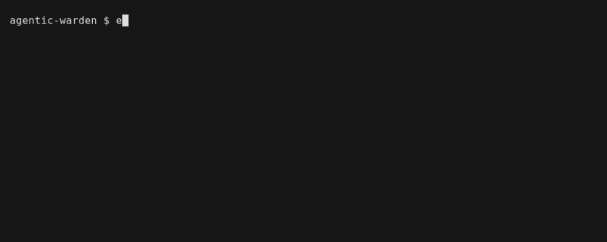
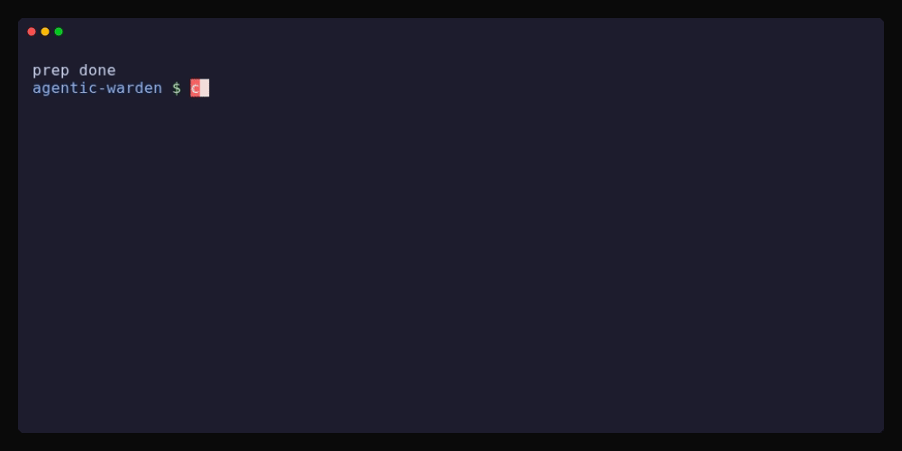
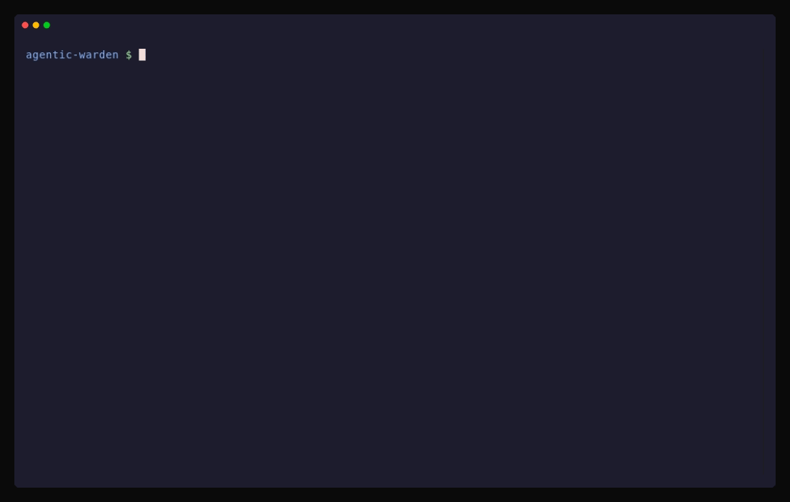

# Quickstart

Seven commands, no root. You run a control plane on your laptop, enroll your own machine, and watch
a rule you applied stop Claude Code in one repository while the same request runs in another.
Nothing is written under `/etc`.

You need Linux or macOS, Go 1.24 or newer, git, and Claude Code installed and logged in. Docker is
not needed. Only the Claude commands in steps 6 and 7 need the login.

Run the steps in one terminal, in order. The control plane from step 2 keeps running in it.

## 1. Build the four binaries

```sh
git clone https://github.com/alchristleo/agentic-warden.git
cd agentic-warden
go build -o bin/ ./cmd/...
export PATH=$PWD/bin:$PATH
ls bin
```

```text
aw
aw-policy
aw-sync
awd
```



Why build from source: [what these binaries write, and how to remove them](./removing.md).

## 2. Start the control plane

```sh
export AWD_ADMIN_TOKEN=try-me
awd serve &
awd_pid=$!
sleep 1
```

```text
AWD_DATABASE_URL is unset; storing policy in memory, which does not survive a restart
listening on
```

`awd` keeps the policy in memory here, so it is for evaluation only. The warnings it prints are
expected: it stores policy in memory, does not sign bundles and leaves the admin console off.



Why a control plane at all: [how policy reaches the agent](./how-it-works.md).

## 3. Apply a policy

The policy is `examples/quickstart.yaml`. It has two rules:

```yaml
version: "quickstart.1"

rules:
  - name: baseline
    agents:
      claude:
        managed:
          permissions:
            deny:
              - Read(./.env)

  - name: payments-repos
    match:
      repos: ["github.com/acme/payments*"]
    agents:
      claude:
        managed:
          permissions:
            deny:
              - Bash(curl *)
```

`baseline` has no `match` block, so it applies everywhere. `payments-repos` applies only to
repositories whose origin matches `github.com/acme/payments*`.

```sh
awd apply examples/quickstart.yaml
```

```text
applied revision quickstart.1 (2 rules)
```



Why a bundle can be signed, and what signing does not stop: [security model](./security-model.md).

## 4. Enroll this machine and sync

```sh
export AW_SYNC_STATE_DIR=~/.aw-try
token=$(awd enroll-token you@acme.com)
AW_SYNC_TOKEN=$token aw-sync enroll --server http://localhost:8080 --agents claude --state-dir ~/.aw-try
aw-sync once --state-dir ~/.aw-try --root claude=$HOME/.aw-try/claude
```

Look for these lines. The machine id and the paths are yours.

```text
enrolled machine
synced bundle quickstart.1: wrote 3 files
```

`--root claude=DIR` keeps the rendered files under `~/.aw-try` instead of `/etc/claude-code`. That is
what makes this trial rootless. `AW_SYNC_STATE_DIR` tells `aw` where to find the result.


Why enrollment uses a single-use token: [security model](./security-model.md).

## 5. Make two repositories and look at what `aw` compiled

```sh
cd ..
for r in payments-api sandbox; do git init -q $r && git -C $r remote add origin https://github.com/acme/$r; done
cd payments-api
aw doctor
```

```text
evaluation mode: state dir
is not the system default; the warnings below are expected for a rootless trial
bundle quickstart.1, repo github.com/acme/payments-api
policy compiled for github.com/acme/payments-api
```

`aw doctor` prints what `aw` would run, without running the agent. It opens with an
`evaluation mode` line, because a rootless trial leaves the machine-wide files empty and `doctor`
says so. It checks only the agents you enrolled. This is the real output on Linux, with paths
shortened (`~` is your home directory, `<node-bin>` the folder that holds `claude`). The `warn:`
lines are the rootless trial talking, not a fault.

```console
wrapper: aw
evaluation mode: state dir ~/.aw-try is not the system default; the warnings below are expected for a rootless trial
policy:  ~/.aw-try/aw-bundle.json (bundle quickstart.1, repo github.com/acme/payments-api)
sync:    ~/.aw-try
  machine: 14a6d33c76d4908e3ffb7e9cb46030e9 at http://localhost:8080
  synced:  0s ago, version quickstart.1

agent claude
  binary: <node-bin>/claude
  warn:   no policyHelper in /etc/claude-code: organization policy is not enforced on bare `claude`
  warn:   no bundle at /etc/claude-code/aw-bundle.json: aw-policy emits no settings until aw-sync has run
  ok:     bundle signature: unsigned deployment
  warn:   enrolled before bundle signing; re-enroll to pin a key
  warn:   ~/.aw-try/aw-bundle.json is owned by uid 1000, not root: its owner can replace the file and the key it is checked against together, and the check would still report verified
  warn:   AW_SYNC_STATE_DIR points this report at ~/.aw-try: the bundle-signature finding above describes that directory, not /var/lib/agent-wrapper, which is where aw-policy reads the bundle it enforces at session start
  args:   --settings ~/.cache/agent-wrapper/claude/settings-c487d96dc708.json
  file:   ~/.cache/agent-wrapper/claude/settings-c487d96dc708.json
  note:   settings layers (low to high): managed (org, locked)
  note:   merged settings written to ~/.cache/agent-wrapper/claude/settings-c487d96dc708.json
  note:   policy compiled for github.com/acme/payments-api
```

Now read the settings file `aw` will hand to Claude Code:

```sh
settings=$(aw doctor | sed -n 's/^  file: *//p')
cat "$settings"
```

```text
"Read(./.env)"
"Bash(curl *)"
```

The `payments-api` repository gets both denies. `sandbox` would get only the `.env` one.



Why `doctor` warns about ownership: [security model](./security-model.md).

## 6. Ask Claude to run curl in both repositories

Same command in both. In `payments-api` the policy denies `curl` even though the command allows it,
because an organization deny overrides a developer's allow. In `sandbox` there is no such deny, so
it runs.

The prompt goes before `--allowedTools`, which takes a list and would otherwise swallow it.

<!-- check: skip (needs a logged-in Claude) -->
```sh
aw claude -p "Run: curl -sI https://example.com and show the status line" --allowedTools "Bash(curl *)"
```

Claude's wording changes from run to run. This is one real example from `payments-api`. The command
did not run:

```text
Command didn't run. Permission to run `curl -sI https://example.com` was denied, so I have no status line to show.
```

Now `sandbox`:

<!-- check: skip (needs a logged-in Claude) -->
```sh
cd ../sandbox
aw claude -p "Run: curl -sI https://example.com and show the status line" --allowedTools "Bash(curl *)"
```

An example of what you get back. The command ran:

```text
Status line:

HTTP/2 200
```

The `.env` rule applies in both repositories. Claude Code's own text for it is stable, and you can
look for it:

<!-- check: skip (needs a logged-in Claude) -->
```sh
aw claude -p "Print the contents of .env"
```

```text
File is in a directory that is denied by your permission settings.
```

The model puts its own prose around that line. The line itself comes from Claude Code.


Why a refusal is not proof against everything: [threat model](./threat-model.md).

## 7. Change the rule, then pull the plug

Copy the policy, bump its version and add a second deny to the payments rule:

```sh
cd ../agentic-warden
sed 's/quickstart.1/quickstart.2/' examples/quickstart.yaml > quickstart.2.yaml
echo '              - Bash(wget *)' >> quickstart.2.yaml
awd apply quickstart.2.yaml
aw-sync once --state-dir ~/.aw-try --root claude=$HOME/.aw-try/claude
```

```text
applied revision quickstart.2 (2 rules)
synced bundle quickstart.2: wrote 3 files
```

Look at the new compiled rule in `payments-api`:

```sh
cd ../payments-api
settings=$(aw doctor | sed -n 's/^  file: *//p')
cat "$settings"
```

```text
"Bash(curl *)"
"Bash(wget *)"
```

Now stop the control plane and sync once more:

```sh
kill $awd_pid
wait $awd_pid || true
aw-sync once --state-dir ~/.aw-try --root claude=$HOME/.aw-try/claude || echo "exit status $?"
```

```text
connection refused
exit status 1
```

The sync fails, exits 1 and leaves the files as they were. The policy still applies, because `aw`
compiles from the bundle on local disk:

```sh
settings=$(aw doctor | sed -n 's/^  file: *//p')
cat "$settings"
aw-sync status --state-dir ~/.aw-try
```

```text
"Bash(curl *)"
"Bash(wget *)"
last error: sync: reaching the control plane at http://localhost:8080
```

Run the step 6 command once more with `awd` stopped. You get the same refusal. The policy is a file
you own, and it fails safe.

<!-- check: skip (needs a logged-in Claude) -->
```sh
aw claude -p "Run: curl -sI https://example.com and show the status line" --allowedTools "Bash(curl *)"
```


Why a stopped control plane changes nothing: [how it works](./how-it-works.md). To clean up, see
[removing Agentic Warden](./removing.md): for this trial it is `rm -rf ~/.aw-try ~/.cache/agent-wrapper`
and deleting the clone.

## Next

- [Enforce the same rule on plain `claude`](./enforce-plain-claude.md) on a test machine, with sudo.
- [Write your first policy](./write-first-policy.md).

**Bring your rules.** See it against your own policy. [Request a demo](/demo)
